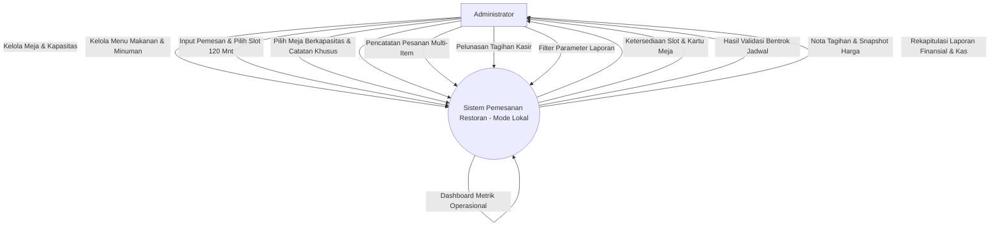
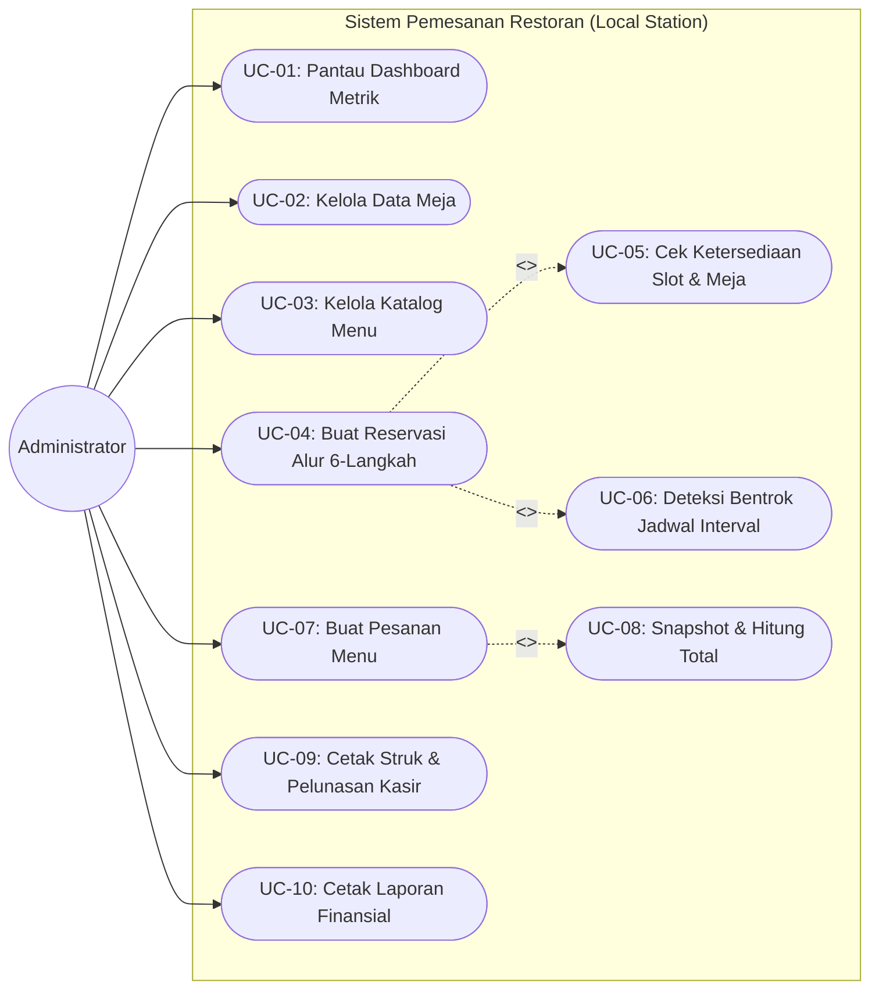
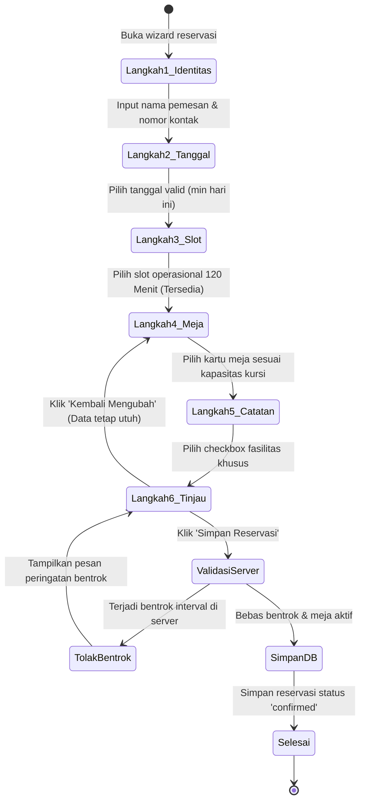
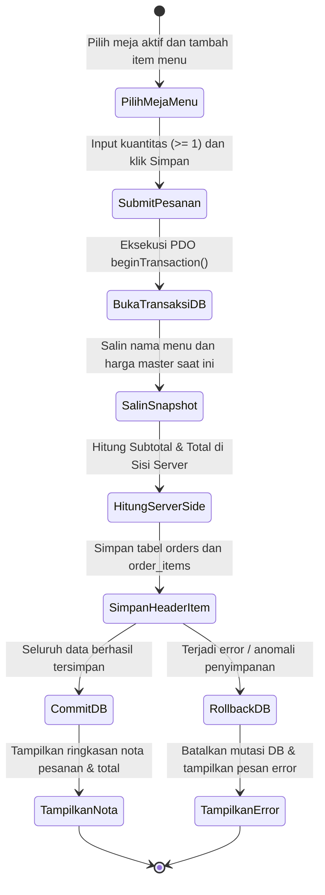
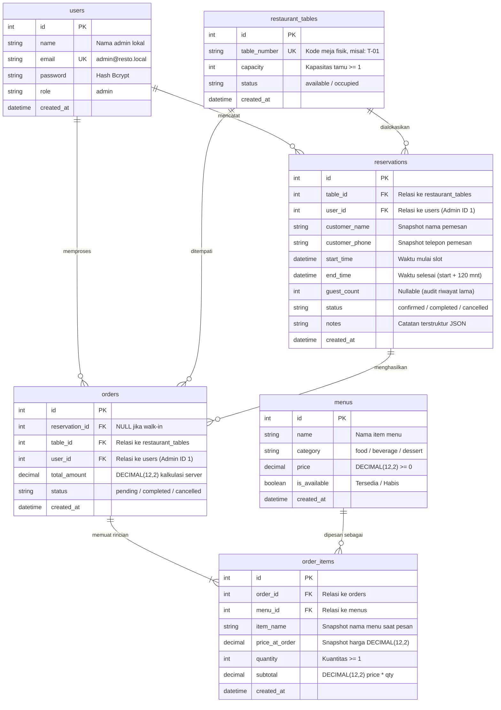
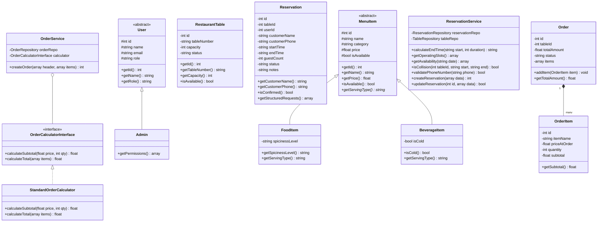

# DOKUMEN PEMODELAN SISTEM
## Sistem Pemesanan Restoran (*Restaurant Reservation & Ordering System*)

* **Kode Dokumen**: DOC-MOD-002
* **Versi**: 2.1.0 (Revisi Sistem Lokal - Aktor Tunggal: Administrator, Alur 6-Langkah Reservasi Terpadu, Penghapusan Master Pelanggan)
* **Status**: Disetujui
* **Tanggal Penyusunan**: 12 Oktober 2026
* **Penulis**: Mahasiswa Teknik Informatika (Kandidat Asesi BNSP)
* **Target Asesmen**: Skema Sertifikasi Pemrograman BNSP (9 Unit Kompetensi)

---

## 1. PENDAHULUAN
Dokumen Pemodelan Sistem ini merupakan spesifikasi rancang bangun perangkat lunak dari [docs/analisis-kebutuhan.md](file:///d:/Documents/Projek/restaurant/docs/analisis-kebutuhan.md). Sistem dirancang sebagai aplikasi lokal terintegrasi untuk kasir dan manajemen restoran dengan **Aktor Tunggal: Administrator**. Pemodelan ini mentransformasikan kebutuhan fungsional dan aturan bisnis ke dalam Diagram Konteks, DFD Level 1, Use Case Diagram, Activity Diagram, Entity Relationship Diagram (ERD), Class Diagram OOP, spesifikasi modul, dan Traceability Matrix.

---

## 2. DIAGRAM KONTEKS (CONTEXT DIAGRAM / DFD LEVEL 0)

Diagram konteks mendeskripsikan batas sistem dan interaksi aplikasi dengan satu entitas eksternal: **Administrator**.



---

## 3. DATA FLOW DIAGRAM (DFD) LEVEL 1

DFD Level 1 menguraikan sistem operasional restoran menjadi 4 proses utama dan interaksinya dengan 5 penyimpan data (*data stores*):

```mermaid
flowchart TD
    Admin[Administrator]

    subgraph PROSES_OPERASIONAL
        P1["1.0 Kelola Master Meja & Menu"]
        P2["2.0 Kelola Reservasi Alur 6-Langkah"]
        P3["3.0 Kelola Pesanan & Snapshot Harga"]
        P4["4.0 Buat Rekapitulasi Laporan"]
    end

    subgraph DATA_STORES
        D1[("D1: restaurant_tables")]
        D2[("D2: menus")]
        D3[("D3: reservations")]
        D4[("D4: orders")]
        D5[("D5: order_items")]
    end

    %% P1 Master Data
    Admin -->|CRUD Meja & Menu| P1
    P1 -->|Simpan Data Meja| D1
    P1 -->|Simpan Data Menu| D2

    %% P2 Reservasi (Identitas Pemesan Tersimpan Langsung di D3)
    Admin -->|Input Pemesan, Slot 120 Mnt, Meja & Catatan| P2
    P2 <-->|Baca Kapasitas Meja & Status| D1
    P2 <-->|Validasi Jadwal Eksis (Cek Bentrok Slot)| D3
    P2 -->|Simpan Snapshot Pemesan & Reservasi| D3

    %% P3 Pesanan
    Admin -->|Input Pesanan Item Meja| P3
    P3 <-->|Baca Harga Menu Terkini| D2
    P3 <-->|Tautkan Meja / Reservasi| D3
    P3 -->|Simpan Header Pesanan| D4
    P3 -->|Simpan Snapshot Harga Detail Item| D5

    %% P4 Laporan
    Admin -->|Filter Rentang Tanggal & Status| P4
    P4 <-->|Rekap Data Reservasi| D3
    P4 <-->|Rekap Data Pesanan Lunas| D4
    P4 -->|Tampilan & Cetak Laporan Formal| Admin
```

---

## 4. USE CASE DIAGRAM & DESKRIPSI USE CASE

### 4.1 Use Case Diagram (Aktor Tunggal: Administrator)



### 4.2 Deskripsi Use Case Terpilih

#### Deskripsi UC-04: Buat Reservasi Alur 6-Langkah
* **Aktor**: Administrator.
* **Prakondisi**: Master data meja telah tersedia di sistem.
* **Pascakondisi**: Reservasi tersimpan dengan status `confirmed`, identitas pemesan tersimpan permanen (*snapshot*), durasi alokasi 120 menit.
* **Skenario Normal**:
  1. Administrator membuka wizard reservasi baru.
  2. **Langkah 1**: Administrator mengisi nama pemesan dan nomor telepon kontak (tanpa memilih dari master pelanggan).
  3. **Langkah 2**: Administrator memilih tanggal kunjungan (tanggal lampau otomatis nonaktif).
  4. **Langkah 3**: Administrator memilih salah satu slot waktu operasional 120 menit (misal 12.00–14.00 WIB). Sistem menampilkan badge ketersediaan slot.
  5. **Langkah 4**: Administrator memilih meja dari kartu visual berdasarkan kapasitas kursi fisik yang dibutuhkan. Meja yang penuh/rusak dinonaktifkan.
  6. **Langkah 5**: Administrator memilih checkbox kebutuhan khusus (*baby chair*, kursi roda, jendela, dekorasi, lainnya).
  7. **Langkah 6**: Administrator meninjau ringkasan lengkap data pemesanan, kemudian menekan "Simpan Reservasi".
  8. Sistem memverifikasi ulang jadwal di server terhadap bentrok interval $(\text{Start Baru} < \text{End Lama}) \land (\text{End Baru} > \text{Start Lama})$.
  9. Sistem menyimpan data reservasi atomik dan menampilkan notifikasi berhasil.
* **Skenario Alternatif**:
  * **8a. Terjadi Bentrok Jadwal**: Meja baru saja dipesan oleh pemesanan lain. Sistem menolak transaksi dan meminta admin memilih meja atau slot lain tanpa menghapus data input identitas yang telah diisi.

---

## 5. ACTIVITY DIAGRAM

### 5.1 Activity Diagram: Alur Reservasi Meja 6 Langkah Terpadu



### 5.2 Activity Diagram: Alur Pembuatan Pesanan & Transaksi Atomik



---

## 6. ENTITY RELATIONSHIP DIAGRAM (ERD)

Skema basis data relasional 3NF (*Third Normal Form*) dengan MySQL/MariaDB InnoDB (tanpa tabel master pelanggan):



---

## 7. CLASS DIAGRAM (DIAGRAM KELAS OOP)

Class Diagram ini memenuhi seluruh target pada Unit **J.620100.018.02 (Pemrograman Berorientasi Objek)**:
1. **Inheritance & Overriding**:
   * Kelas abstrak **`MenuItem`** diwarisi oleh subclass **`FoodItem`** dan **`BeverageItem`**, yang meng-override method `getServingType(): string`.
   * Kelas abstrak **`User`** diwarisi oleh **`Admin`**.
2. **Encapsulation**: Seluruh properti berakses `protected` atau `private` dengan `getter` dan `setter`.
3. **Polymorphism via Interface**: **`OrderCalculatorInterface`** diimplementasikan oleh **`StandardOrderCalculator`**.
4. **Pemisahan Lapisan**: Model/Entity, Service (Logika Bisnis), Repository (Akses PDO), dan Controller.



---

## 8. SPESIFIKASI MODUL PROGRAM

| Modul | Controller / Service Terkait | Input | Proses Utama | Output | Penanganan Kesalahan |
| :--- | :--- | :--- | :--- | :--- | :--- |
| **Dashboard** | `DashboardController.php` | - | Agregasi data meja, pesanan hari ini, dan kas masuk. | Kartu metrik & ringkasan operasional harian. | Nilai 0 jika data kosong. |
| **Meja** | `TableController.php`<br>`TableRepository.php` | Nomor meja, kapasitas | Validasi nomor meja unik, kapasitas kursi $\ge 1$. | Data meja tersimpan di database. | Error: "Nomor meja sudah terdaftar / kapasitas minimal 1". |
| **Menu** | `MenuController.php`<br>`MenuRepository.php` | Nama, kategori, harga | Validasi harga $\ge 0$, tipe `DECIMAL(12,2)`. | Menu aktif di katalog. | Error: "Harga tidak boleh bernilai negatif". |
| **Reservasi** | `ReservationController.php`<br>`ReservationService.php` | Nama pemesan, telepon, tanggal, slot 120 mnt, meja, catatan | 1. Validasi identitas pemesan.<br>2. Validasi slot 120 mnt.<br>3. Pemilihan kartu meja berkapasitas.<br>4. Serialisasi catatan JSON.<br>5. Deteksi bentrok interval di server. | Reservasi `confirmed`. | Error: "Nomor telepon tidak valid" atau "Meja baru saja dipesan pada slot waktu tersebut". |
| **Pesanan** | `OrderController.php`<br>`OrderService.php` | ID Meja, array items [menu_id, qty] | 1. Buka transaksi DB.<br>2. Salin snapshot nama & harga.<br>3. Hitung subtotal & total.<br>4. Simpan header & detail.<br>5. Commit DB. | ID Pesanan tersimpan, nota tagihan. | Jika salah satu item gagal: eksekusi `rollBack()`, batalkan seluruh mutasi. |
| **Laporan** | `ReportController.php`<br>`ReportService.php` | Tanggal mulai, tanggal akhir, status | Filter query berdasarkan rentang tanggal dan status transaksi, pemisahan nilai finansial (Gross vs Realized). | Tampilan rekapitulasi & cetak bersih. | Notifikasi: "Tanggal mulai tidak boleh melebihi tanggal akhir". |

---

## 9. TRACEABILITY MATRIX (MATRIKS KETERLACAKAN SPESIFIKASI)

| ID Kebutuhan | Komponen Use Case | Class / Modul Pengimplementasi | File Terkait | Target Kasus Uji | Unit Kompetensi BNSP |
| :--- | :--- | :--- | :--- | :--- | :--- |
| **FR-01 (Dashboard)** | UC-01 | `DashboardController`<br>`ReportService` | `app/Controllers/DashboardController.php` | `DashboardTest::testMetricsDisplay` | J.620100.016.01 |
| **FR-02 (Meja)** | UC-02 | `TableController`<br>`RestaurantTable` | `app/Controllers/TableController.php`<br>`app/Models/RestaurantTable.php` | `TableTest::testTableCapacityMustBeGreaterThanZero` | J.620100.017.02<br>J.620100.021.02 |
| **FR-03 (Menu & OOP)** | UC-03 | `MenuController`<br>`MenuItem` (`FoodItem`/`BeverageItem`) | `app/Controllers/MenuController.php`<br>`app/Models/MenuItem.php` | `MenuTest::testFoodItemInheritanceAndOverriding`<br>`MenuTest::testBeverageItemInheritanceAndOverriding` | J.620100.017.02<br>J.620100.018.02 |
| **FR-04 (Reservasi 6-Langkah)** | UC-04<br>UC-05<br>UC-06 | `ReservationController`<br>`ReservationService`<br>`ReservationRepository` | `app/Controllers/ReservationController.php`<br>`app/Services/ReservationService.php` | `ReservationTest::testGetOperatingSlotsStructure`<br>`ReservationTest::testValidatePhoneNumber`<br>`ReservationTest::testFormatNotesToStructuredJson` | J.620100.009.01<br>J.620100.017.02<br>J.620100.033.02 |
| **FR-05 (Deteksi Bentrok)** | UC-06 | `ReservationService`<br>`ReservationRepository` | `app/Services/ReservationService.php` | `ReservationTest::testCalculateEndTimeFixedTwoHours` | J.620100.017.02<br>J.620100.021.02 |
| **FR-06 (Pesanan & Snapshot)** | UC-07<br>UC-08 | `OrderService`<br>`OrderCalculatorInterface`<br>`StandardOrderCalculator` | `app/Services/OrderService.php`<br>`app/Services/StandardOrderCalculator.php` | `OrderCalculatorTest::testCalculateSubtotalPrecision`<br>`OrderCalculatorTest::testCalculateTotalMultiItems` | J.620100.018.02<br>J.620100.021.02<br>J.620100.033.02 |
| **FR-07 (Status)** | UC-04, UC-07, UC-09 | `Reservation`<br>`Order` | `app/Models/Reservation.php`<br>`app/Models/Order.php` | `ReservationTest::testReservationModelStructuredNotes` | J.620100.017.02 |
| **FR-08 (Laporan)** | UC-10 | `ReportController`<br>`ReportService` | `app/Controllers/ReportController.php`<br>`app/Services/ReportService.php` | `ReportService::getFinancialSummary` | J.620100.017.02<br>J.620100.021.02 |
